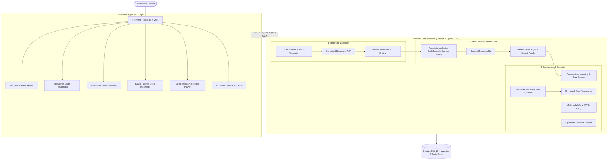

# OpenDocs: Voice & Learning Engine

> **A high-assurance, code-safe, multimodal open-source documentation assistant and AI-powered personalized learning platform.**

---

## 🌟 Overview & Problem Statement

Most open-source developer documentation is written in English, heavily technical, and difficult for non-native speakers, students, and beginners. Standard machine translation frequently corrupts terminal commands, package names, code syntax, and file paths—breaking executable instructions and frustrating developers. Furthermore, static documentation lacks interactivity, contextual runtime error assistance, and personalized learning aids.

**OpenDocs** bridges this gap with an integrated full-stack architecture:
1. **Provably Code-Safe Multilingual Translation:** Translates technical documentation into Indian and international languages (Kannada, Hindi, Spanish, etc.) while mathematically guaranteeing zero modification to technical code, CLI commands, or API signatures.
2. **Interactive Aligned Reader:** Side-by-side or stacked bilingual reading experience with verification proof badges and karaoke-style text-to-speech audio narration.
3. **Interactive Code Playground & Sandbox:** Multi-language code execution playground with syntax explanations, real-time output, and isolated execution.
4. **Contextual Error-to-Docs Diagnostics:** Ingests raw stack traces and terminal error logs, categorizes failure modes, and grounds fixes directly against official documentation anchors.
5. **Personalized Learning Synthesis:** Transforms documentation into active recall flashcards (SM-2 spaced repetition), multi-level concept explanations (Beginner, Intermediate, Advanced, ELI5), and self-assessment quizzes.
6. **Continuous Upstream Drift Monitoring:** Detects upstream documentation updates via ETag/content hashing, diffs semantic AST changes, and invalidates outdated learning assets.

---

## 🏗️ Full-Stack System Architecture



---

## 🚀 Key Features

### 💻 Frontend (React + Vite)
- **Bilingual Aligned Reader (`Reader.jsx`):** Aligned reading with toggleable target languages (Kannada, Hindi, Spanish), synchronized paragraph highlights, and verification confidence tags.
- **Code Playground (`CodePlayground.jsx`):** Multi-language editor (Python, JavaScript, C, C++, Java) with sample snippets and live output.
- **Code Explanation Engine (`CodeExplanation.jsx`):** Deep syntax breakdowns tailored across three cognitive levels: Beginner, Intermediate, and Advanced.
- **Error to Documentation Assistant (`ErrorToDocs.jsx`):** Diagnostic engine that classifies runtime error families (Syntax, Type, ModuleNotFound, Network) and links to actionable fixes.
- **Voice Assistant (`VoiceAssistant.jsx`):** Hands-free voice navigation, question answering, and speech synthesis with audio cue synchronization.
- **Command Palette (`CommandPalette.jsx`):** Instant keyboard-first navigation via `Ctrl + K` or `Cmd + K`.

### 🛡️ Backend (FastAPI + Python)
- **Dual-Mode Code Protection:**
  - *Mode A (Structural):* Fenced code blocks (`<pre>`, `<code>`) are extracted byte-for-byte and never passed to the translation model.
  - *Mode B (Lexical):* Inline commands, flags, package names, and URLs are replaced with atomic, non-translatable sentinels (`⟦k12⟧`), translated in prose context, and reconstituted with 1-to-1 arity checks.
- **Cryptographic Preservation Ledger:** RFC 6962 compliant Merkle Tree hash chain guaranteeing that 100% of technical code tokens survived translation unmodified. Independently verifiable offline via `verify.py`.
- **SSRF Network Shield (`FetchGuard`):** Strict URL validation, DNS pinning, private IP range blocks (RFC 1918, RFC 3927), and cloud metadata protection (`169.254.169.254`).
- **Isolated Code Sandbox:** Multi-language execution container with memory limits (128MB), CPU timeouts (5s), and AST-level dangerous import filtering.
- **Upstream Documentation Drift Monitor:** Background monitor tracking external doc updates via ETag/hash diffing and webhooks.

---

## 📁 Repository Structure

```text
OpenDoc/
├── frontend/                     # React 18 + Vite Client Application
│   ├── public/                   # Static assets & icons
│   ├── src/
│   │   ├── components/           # UI Components (Reader, Navbar, CommandPalette, etc.)
│   │   ├── pages/                # Views (Home, Reader, CodePlayground, ErrorToDocs, etc.)
│   │   ├── services/             # API client & diagnostic services (api.js)
│   │   ├── style/                # Scoped CSS styling sheets
│   │   ├── App.jsx               # Application routes & layout
│   │   └── main.jsx              # Vite entry point
│   └── index.html                # Single page app template
├── backend/                      # FastAPI Python Backend Service
│   ├── app/
│   │   ├── adapters/             # Translation provider router (IndicTrans2, DeepL, Mock)
│   │   ├── api/                  # REST API endpoints (documents, learning, monitor, sandbox, qa, speech)
│   │   ├── core/                 # DocAST, Merkle Tree, Invariant Protection, Learning Engine
│   │   ├── models/               # Pydantic v2 schemas and validation models
│   │   ├── services/             # SSRF Guard, Audio Engine, Sandbox, Diagnostics, Store
│   │   └── main.py               # FastAPI entry point with CORS & Health endpoints
│   ├── docker/                   # Dockerfile.api and compose.yml (with pgvector)
│   ├── tests/                    # 10 unit & invariant test suites (SSRF, AST, Sandbox, etc.)
│   ├── .env.example              # Environment variables template
│   ├── requirements.txt          # Production Python dependencies
│   ├── pytest.ini                # Pytest test runner configuration
│   ├── QUICKSTART.md             # Backend quickstart guide
│   └── verify.py                 # Standalone offline Merkle proof verifier
├── package.json                  # Root npm scripts & frontend dependencies
├── vite.config.js                # Vite configuration with proxy rules
└── README.md                     # Full-stack documentation
```

---

## ⚡ Quickstart Guide

### Prerequisites
- **Node.js** (v18.0.0 or higher) & **npm**
- **Python** (v3.10 or higher) & **pip**
- *(Optional)* **Docker & Docker Compose**

---

### 1. Run the Backend

```bash
# 1. Navigate to the backend directory
cd backend

# 2. (Recommended) Create and activate a virtual environment
python -m venv venv

# On Windows:
.\venv\Scripts\activate
# On macOS / Linux:
source venv/bin/activate

# 3. Install dependencies
pip install -r requirements.txt

# 4. Start the FastAPI development server
python -m uvicorn app.main:app --reload --port 8000
```

- **Backend API:** `http://localhost:8000`
- **Interactive Swagger Docs:** `http://localhost:8000/docs`
- **API Health Check:** `http://localhost:8000/api/health`

---

### 2. Run the Frontend

Open a second terminal window:

```bash
# 1. From the repository root
npm install

# 2. Start the Vite development server
npm run dev
```

- **Frontend Application:** `http://localhost:5173`

---

### 3. Run with Docker Compose (Alternative)

To launch the full backend stack including PostgreSQL with `pgvector`:

```bash
docker compose -f backend/docker/compose.yml up -d --build
```

---

## 🧪 Running the Backend Verification & Invariant Tests

The backend includes a comprehensive test suite covering SSRF protection, AST invariant preservation, sandbox isolation, and audio processing:

```bash
cd backend
python -m pytest tests/ -v
```

To test standalone offline Merkle proof verification:
```bash
python backend/verify.py <proof_file.json>
```

---

## 👥 Team Essential Engineers and Team Members

- **J Bhuvanesh**
- **Anusha A**
- **Preetam Rathod**
- **S.Md.Naqeeb**
